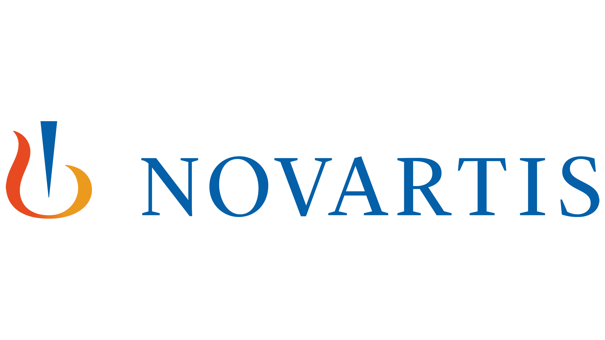
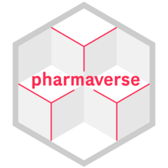
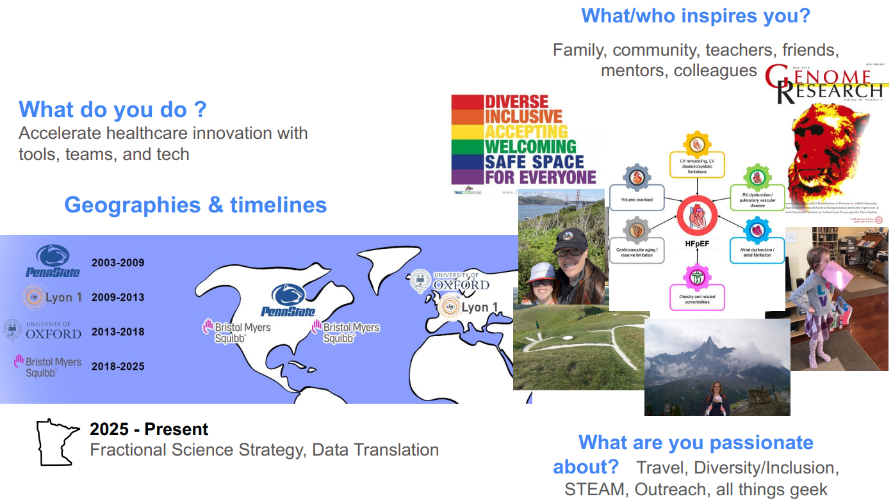
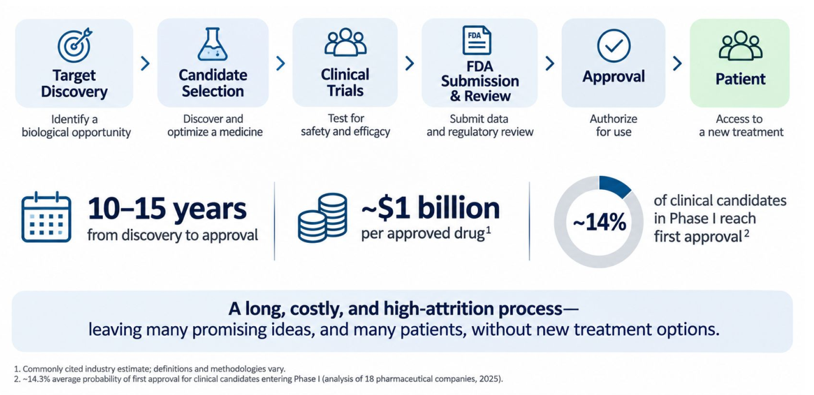
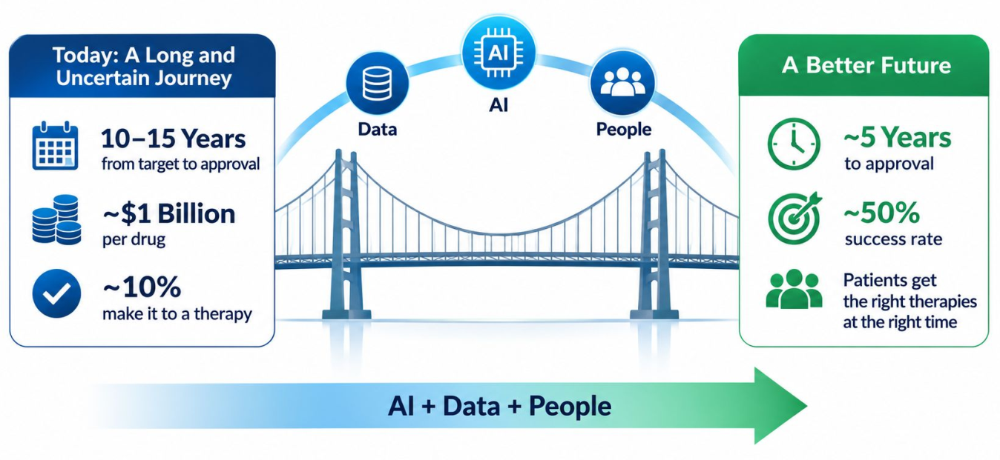
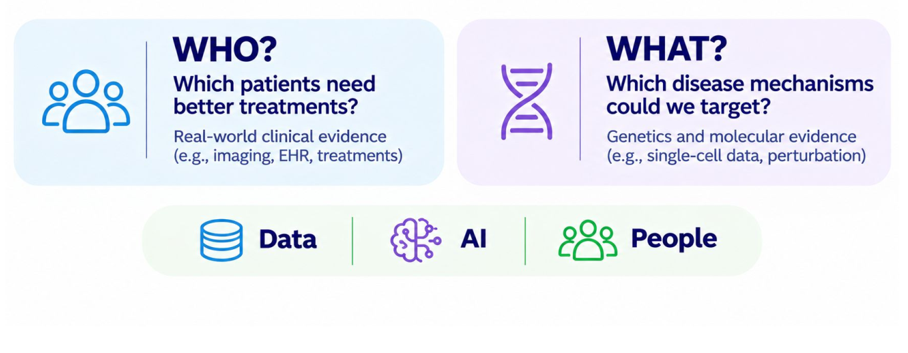

## Agenda

* Panel Introductions
* AI in Drug Discovery and Development
* "Fireside Chat" (panelist Q&A)
* Audience Q&A

## Brian Repko [(he/him)]{style="font-size: 70%"}

* 11 years at Novartis (now retired)
* 8 years in oncology research
* 5 years in an internal CRO (-omic biomarkers)
  * bulk RNA, DNA panel, scRNA, T/B cell, CITE-seq, spatial
  * including validation and qualification

* Minneapolis-St Paul "chapter lead" for Bits-in-Bio
* R/Pharma and `{pharmaverse}` contributor

{.absolute top=5 left=700 width="80"}
{.absolute top=0 left=800 width="200"}

{.absolute top=80 left=800 width="80"}

{.absolute top=80 left=870 width="80"}

## Dr. Erika Kvikstad [(she/her)]{style="font-size: 70%"}

## Dr. Geof Hannigan [(he/him)]{style="font-size: 70%"}

## [What is Drug Discovery and Development?]{.r-fit-text}

## AI and DD&D - Brian (1/2) {.smaller}

* AI has always been a part of DD&D - comp.bio and comp.chem as fields
  * New focus on GenAI, agentic workflows or skills, and improved tools

* Novartis efforts - data42, scientific vs operational AI, tooling
  * Huge efforts to collect and connect preclinical, clinical trial, and real-world data
  * Investments in predictive safety/tox, therapeutic design, and lab automation

* Data fit, quality, and integration are key to model success
  * Unresolvable gaps in data - missing / mistaken / methods
  * Existing knowledge is sometimes not reproducible or not accurate

* Hype is a bit out of control (Anthropic S-1) and DD&D is a miracle
  * We are still learning basic biology and developing new methods (shRNA/sgRNA)
  * Genuine effort on where to set the bar here

## AI and DD&D - Brian (2/2) {.smaller}

* Drug Development / GXP
  * CDISC efforts - 360i, USDM / TMF, SDTM-ADAM and data engineering coding
  * Only non-critical tasks and then with auditing and approvals
  * Validation of agents similar to that of R and R packages (with non-determinism)

* Regulatory Issues
  * FDA already using AI for review of protocols and trial data (ELSA)
  * Sponsors learning how to do the same on their side prior to submission

* What is successful use of AI in DD&D? What is ROI on the tools?
  * Somewhat timelines (and perhaps cost) - biological latency still exists
    * If we lower cost, does that change what we go after?
  * Success as improving p(success) - better models, biomarkers, and trial designs
    * If more drug candidates, do we create a bottleneck with patients? sites?

## AI and DD&D - Erika (1/2)

[We can build a better drug discovery process]{.r-fit-text}

## AI and DD&D - Erika (2/2)

[Two questions on the path to better medicines]{.r-fit-text}

## AI and DD&D - Geof (1/2) {.smaller}

## AI and DD&D - Geof (2/2) {.smaller}

# Fireside Chat

# Audience Q&A

# Thank you!

